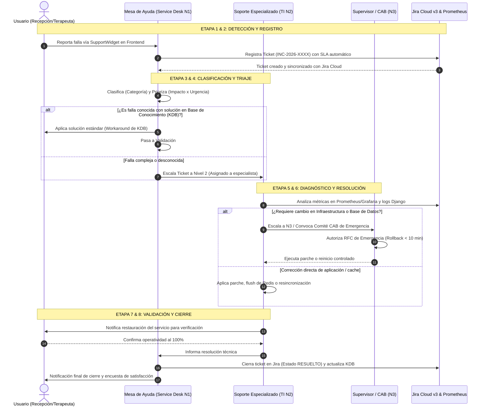
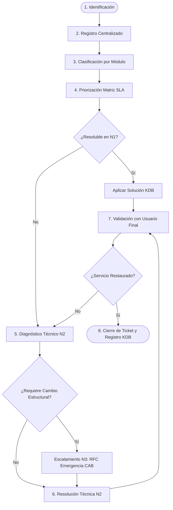

# PLAN PROFESIONAL DE GESTIÓN DE INCIDENCIAS DE TI
## SISTEMA INTEGRAL SUMAQ SPA & WELLNESS (ITIL v4 & ISO/IEC 20000-1)

---

| **UNIVERSIDAD TECNOLÓGICA DEL PERÚ (UTP)** | **FACULTAD DE INGENIERÍA DE SISTEMAS E INFORMÁTICA** |
| :--- | :--- |
| **Curso:** | Curso Integrador II: Sistemas (Semana 14 – Sesión 27) |
| **Docente:** | MBA Mg. Ing. Rene Alonso Nieto Valencia (`c26305@utp.edu.pe`) |
| **Proyecto:** | SUMAQ-web: Plataforma Web de Gestión Integral, Reservas, POS y Telemetría TI |
| **Integrantes:** | Anthony Luque (Soporte TI / Integrador), Rafael Ramírez (Admin / Arquitectura), Bryan Mango (DevOps / QA) |
| **Fecha:** | Noviembre de 2026 |
| **Versión del Plan:** | v2.0 (Alineado a ITIL v4, Jira Service Management y Observabilidad Cloud) |

---

## 1. OBJETIVO DEL PLAN DE GESTIÓN DE INCIDENTES

Diseñar, normar e implementar un proceso profesional de **Gestión de Incidentes de Tecnología de Información (TI)** para la plataforma empresarial **SUMAQ SPA & Wellness**, estableciendo estrategias sistemáticas para su:
1. **Detección e Identificación Proactiva y Reactiva.**
2. **Registro centralizado y categorización estandarizada.**
3. **Priorización matricial (Impacto $\times$ Urgencia).**
4. **Atención escalonada por niveles de soporte (N1, N2 y N3/CAB).**
5. **Resolución, validación y restauración del servicio en el menor tiempo posible minimizando el impacto operativo.**
6. **Alimentación continua a la Gestión de Problemas (RCA) y Gestión del Conocimiento (KDB).**

> [!IMPORTANT]
> **Definición ITIL v4 del Incidente:**
> Una interrupción no planificada de un servicio de TI o una reducción imprevista en la calidad del mismo. El propósito de este proceso es restaurar la operación normal del servicio acordada en los SLAs lo más rápido posible.

---

## 2. PRESENTACIÓN DEL CASO DE ESTUDIO Y CONTEXTO EMPRESARIAL

### 2.1. Contexto de Negocio: SUMAQ SPA & Wellness
**SUMAQ SPA** es una empresa de servicios de bienestar, hidroterapia y estética integral con atención presencial en cabinas y transacciones digitales a través de su portal web.
La plataforma tecnológica gestiona simultáneamente:
* **Autoservicio de Clientes:** Catálogo de servicios, reserva de citas en línea y pagos anticipados con tarjeta.
* **Punto de Venta (POS) y Caja:** Facturación de boletas/tickets, cobro en recepción y registro de consumos.
* **Operación de Cabinas y Terapeutas:** Asignación de salas, control de insumos (BOM) y fichas de salud.
* **Mando Ejecutivo y Gobernanza TI:** Monitoreo de réplica de base de datos, mesa de ayuda interna y Comité de Control de Cambios (CAB).

### 2.2. Ecosistema Tecnológico de Soporte (Arquitectura Real)
* **Frontend:** Single Page Application (SPA) en React 18, TypeScript, Tailwind CSS y Vite.
* **Backend:** Microservicios y APIs RESTful construidas con Django REST Framework 5.x y Python 3.12.
* **Base de Datos de Alta Disponibilidad:** MySQL 8.0 en arquitectura de **Replicación Master-Slave** (Master transaccional en puerto `3308` para escrituras y pedidos; Slave en puerto `3309` exclusivo para reportes y analítica pesada).
* **Caché y Gestión de Sesiones:** Redis 7.x en memoria para amortiguar consultas concurrentes y listas de revocación JWT.
* **Observabilidad y Telemetría Continua:** Prometheus para recolección de métricas cada 5 segundos y Grafana Cloud/Local para tableros de rendimiento.
* **Infraestructura Cloud:** Despliegue en Máquina Virtual Linux Ubuntu en Microsoft Azure (`68.155.146.110`) orquestada mediante Docker Compose (7 contenedores interconectados).
* **Integración Externa de Mesa de Ayuda:** Integración directa por API REST con **Jira Cloud v3** (`sumaq-dev.atlassian.net`) para trazabilidad auditable.

```
+----------------------------------------------------------------------------------------------------+
|                                    ARQUITECTURA DE PRODUCCIÓN SUMAQ                                |
|                                                                                                    |
|    [ Clientes Web ]          [ Recepción / POS ]         [ Terapeutas / Admin ]                    |
|           \                         |                         /                                    |
|            +------------------------+------------------------+                                     |
|                                     |                                                              |
|                         [ NGINX Reverse Proxy (SSL) ]                                              |
|                                     |                                                              |
|                     +---------------+---------------+                                              |
|                     |                               |                                              |
|             [ React Frontend ]              [ Django Backend API ] <---> [ Jira Cloud Service Desk]|
|               (Puerto 80/443)                  (Puerto 8000)                                       |
|                                                     |                                              |
|                           +-------------------------+-------------------------+                    |
|                           |                         |                         |                    |
|                   [ Redis Caché ]           [ MySQL Master: 3308 ]    [ Prometheus Telemetría ]    |
|                     (Puerto 6379)               (Transaccional)              (Puerto 9090)         |
|                                                     |                             |                |
|                                            (Replicación Binlog)           [ Grafana Dashboards ]   |
|                                                     |                        (Puerto 3001)         |
|                                             [ MySQL Slave: 3309 ]                                  |
|                                                (Solo Lectura)                                      |
+----------------------------------------------------------------------------------------------------+
```

---

## 3. FASE 1: IDENTIFICACIÓN Y CLASIFICACIÓN DE INCIDENTES

### 3.1. Incidentes Típicos Identificados en la Operación de SUMAQ

| ID Incidente | Descripción del Incidente en SUMAQ | Subsistema Afectado | Síntoma Operativo |
| :--- | :--- | :--- | :--- |
| **INC-01** | **Portal Web / Backend API no responde (Error 502/504 Bad Gateway)** | Infraestructura y Servidor Cloud (Azure / Docker) | Clientes y recepcionistas no pueden ingresar al portal ni consultar turnos de cabina. |
| **INC-02** | **Falla Masiva de Autenticación / Error al Iniciar Sesión** | Seguridad & Auth (JWT / Middleware) | Recepcionistas y terapeutas quedan bloqueados; tokens expirados sin renovación. |
| **INC-03** | **Inconsistencia o Error en Reportes de Cierre de Caja / Kardex** | Base de Datos (Desincronización Master-Slave) | La réplica `3309` reporta ventas o inventario no actualizado respecto a la caja Master. |
| **INC-04** | **Lentitud Extrema en Registro de Cobros POS y Citas** | Aplicaciones y Redes (Pool de conexiones agotado) | La pantalla de cobro tarda más de 20 segundos en validar el pago o emitir la boleta PDF. |
| **INC-05** | **Servidor MySQL con Consumo de CPU al 98% (Saturación de Consultas)** | Base de Datos MySQL Master | Bloqueo transaccional de tablas (*Deadlocks*), deteniendo la creación de nuevas citas. |

---

### 3.2. Matriz de Priorización ITIL v4 (Cálculo de Criticidad)

La prioridad no se asigna al azar; se calcula matemáticamente mediante la intersección del **Impacto** (magnitud del daño al negocio y volumen de usuarios afectados) y la **Urgencia** (sensibilidad del servicio al tiempo de inactividad):

$$\text{Prioridad} = f(\text{Impacto}, \text{Urgencia})$$

```
+----------------------------------------------------------------------------+
|                          MATRIZ DE PRIORIZACIÓN ITIL                        |
+--------------------+-------------------------------------------------------+
|                    |                        URGENCIA                       |
|      IMPACTO       |        ALTA         |       MEDIA       |    BAJA     |
+--------------------+---------------------+-------------------+-------------+
| ALTO               |    P1 - CRÍTICA     |     P2 - ALTA     |  P3 - MEDIA |
| (>50% usuarios)    |   (Resolución 2h)   |  (Resolución 8h)  | (Resol. 24h)|
+--------------------+---------------------+-------------------+-------------+
| MEDIO              |      P2 - ALTA      |    P3 - MEDIA     |  P4 - BAJA  |
| (1 departamento)   |   (Resolución 8h)   |  (Resolución 24h) | (Resol. 48h)|
+--------------------+---------------------+-------------------+-------------+
| BAJO               |     P3 - MEDIA      |     P4 - BAJA     |  P4 - BAJA  |
| (1 usuario aislado)|  (Resolución 24h)   |  (Resolución 48h) | (Resol. 48h)|
+--------------------+---------------------+-------------------+-------------+
```

---

### 3.3. Tabla de Clasificación Estandarizada de Incidentes de SUMAQ

Siguiendo las directrices del curso y las categorías formales:

| Código Incidente | Incidente Específico | Categoría / Tipo | Impacto | Urgencia | Prioridad Resultante | Código de Ticket en Código SUMAQ |
| :---: | :--- | :--- | :---: | :---: | :---: | :---: |
| **INC-01** | Caída total del servicio backend / NGINX en Azure | **Infraestructura** | **Alto** | **Alto** | **P1 - Crítica** | `INC-2026-0001` |
| **INC-02** | Falla de login por expiración masiva de JWT | **Seguridad & Auth** | **Alto** | **Medio** | **P2 - Alta** | `INC-2026-0002` |
| **INC-03** | Inconsistencia de reporte financiero en réplica | **Base de Datos** | **Medio** | **Medio** | **P3 - Media** | `INC-2026-0003` |
| **INC-04** | Lentitud de respuesta en checkout POS (>20s) | **Aplicaciones** | **Alto** | **Alto** | **P1 - Crítica** | `INC-2026-0004` |
| **INC-05** | Saturación de CPU en MySQL (98% uso) | **Base de Datos** | **Alto** | **Medio** | **P2 - Alta** | `INC-2026-0005` |
| **INC-06** | Falla de conexión a impresora térmica de recibos | **Hardware / Periférico**| **Bajo** | **Bajo** | **P4 - Baja** | `INC-2026-0006` |

---

## 4. FASE 2: DISEÑO DEL PROCESO Y FLUJO DE ATENCIÓN EN NOTACIÓN BPMN

A continuación se presenta el modelado formal del proceso de gestión de incidentes en notación **BPMN 2.0 (Business Process Model and Notation)** con 4 carriles (*swimlanes*) organizados por nivel de escalamiento y responsabilidad:



### Flujo Detallado de las 8 Etapas del Proceso:



1. **Identificación:** El incidente se detecta por reporte humano (vía el widget flotante de SUMAQ) o de manera automática por alertas de Prometheus si un microservicio cae.
2. **Registro:** El sistema genera un código unívoco correlativo (`INC-YYYY-XXXX`), guarda fecha, hora exacta, solicitante, módulo y captura el estado del navegador.
3. **Clasificación:** Se asigna a una de las categorías tecnológicas (Infraestructura, Aplicaciones, Base de Datos, Redes, Seguridad).
4. **Priorización:** Se evalúa Impacto y Urgencia, fijando el cronómetro regresivo de SLA (ejemplo: P1 = 2 horas).
5. **Diagnóstico:** El especialista N2 inspecciona logs de Django (`logger.error`), transacciones en MySQL y paneles en Grafana.
6. **Resolución:** Se aplica la contramedida (reinicio de contenedor, resincronización de réplica `START REPLICA`, purga de clave Redis).
7. **Validación:** El usuario que reportó el incidente (recepcionista o terapeuta) comprueba que ya puede cobrar o reservar sin errores.
8. **Cierre:** Se documenta la solución técnica en Jira Cloud, se marca el ticket como `RESUELTO` y se publica un artículo en la Base de Conocimiento para agilizar incidentes futuros.

---

## 5. FASE 3: DEFINICIÓN DE ROLES Y RESPONSABILIDADES (MATRIZ RACI)

### 5.1. Definición Funcional de Roles

| Rol ITIL | Cargo en SUMAQ SPA | Responsabilidad Principal |
| :--- | :--- | :--- |
| **Usuario Final / Solicitante** | Recepcionista, Terapeuta, Administrador de Local, Cliente | Reportar oportunamente cualquier interrupción o falla con evidencias visuales y síntomas claros. |
| **Mesa de Ayuda (Service Desk N1)** | Operador de Soporte TI Nivel 1 (Ing. Anthony Luque) | Recepcionar el ticket, verificar datos, clasificar, priorizar y resolver problemas comunes de primer contacto. |
| **Soporte Especializado (TI Nivel 2)** | Ingeniero de Software / DBA / DevOps (Rafael Ramírez / Bryan Mango) | Diagnosticar causas profundas, analizar código fuente, optimizar consultas SQL y aplicar correcciones técnicas. |
| **Supervisor TI / Gestor de Incidentes (Nivel 3)** | Gerente de TI / Presidente del Comité CAB | Gestionar incidentes mayores (P1), convocar cambios de emergencia (ECAB) y aprobar planes de contingencia. |

---

### 5.2. Matriz RACI del Proceso de Gestión de Incidentes

> **Significado RACI:**
> * **R (Responsible):** El rol encargado de realizar la tarea.
> * **A (Accountable):** El rol que aprueba y rinde cuentas del resultado final.
> * **C (Consulted):** El rol consultado por sus conocimientos técnicos.
> * **I (Informed):** El rol que se mantiene informado del avance.

| Actividad del Proceso | Usuario Final | Mesa de Ayuda N1 | Soporte TI N2 | Supervisor / CAB N3 |
| :--- | :---: | :---: | :---: | :---: |
| **1. Detección y Notificación de la Falla** | **R / A** | **I** | **I** | **I** |
| **2. Registro y Creación del Ticket en Jira** | **I** | **R / A** | **I** | **I** |
| **3. Clasificación y Asignación de Prioridad (SLA)**| **I** | **R** | **C** | **A** |
| **4. Diagnóstico Técnico y Rastreo de Causa Raíz** | **I** | **C** | **R / A** | **C** |
| **5. Aprobación de Cambio de Emergencia (RFC)** | **I** | **I** | **C** | **R / A** |
| **6. Implementación de Solución / Workaround** | **I** | **C** | **R** | **A** |
| **7. Validación Operativa con el Usuario** | **R** | **A** | **C** | **I** |
| **8. Cierre Formal del Ticket y Actualización KDB** | **I** | **R / A** | **C** | **I** |

---

## 6. FASE 4: DEFINICIÓN DE ACUERDOS DE NIVEL DE SERVICIO (SLA)

### 6.1. Tabla de SLAs para SUMAQ SPA (Tiempos de Respuesta y Resolución)

En concordancia con los parámetros configurados en el modelo `Ticket` de nuestra plataforma (`backend/apps/ti/models.py`), los compromisos de servicio son:

| Prioridad | Nivel de Criticidad | Tiempo Máximo de Respuesta (MTTA) | Tiempo Máximo de Resolución (MTTR) | Horario de Cobertura | Procedimiento de Escalamiento |
| :---: | :--- | :---: | :---: | :---: | :--- |
| **P1** | **Crítica** (Portal caído, BD bloqueada, pasarela POS caída) | **$< 15$ minutos** | **$\le 2$ horas** | 24/7 (Alta prioridad continua) | Escalamiento inmediato a Nivel 2 y notificación al Gerente de TI y Comité CAB. |
| **P2** | **Alta** (Error masivo de login, saturación CPU >90%, lentitud severa) | **$< 30$ minutos** | **$\le 8$ horas** | Lunes a Domingo (07:00 a 22:00) | Si no se resuelve en 4 horas, se escala a Nivel 3. |
| **P3** | **Media** (Inconsistencia en reportes no urgentes, fallo en 1 cabina) | **$< 2$ horas** | **$\le 24$ horas** | Horario Comercial (08:00 a 20:00) | Atendido por Nivel 1 o programado con Nivel 2. |
| **P4** | **Baja** (Falla de impresora local, solicitud cosmética, duda de interfaz) | **$< 4$ horas** | **$\le 48$ horas** | Días laborables (L-V 09:00 a 18:00) | Atendido por Nivel 1 mediante Base de Conocimiento. |

> [!NOTE]
> * **MTTA (Mean Time to Acknowledge):** Tiempo transcurrido desde que el usuario emite el reporte hasta que la Mesa de Ayuda confirma su recepción y asigna especialista.
> * **MTTR (Mean Time to Resolve):** Tiempo total hasta que la funcionalidad queda completamente restaurada en producción.

---

## 7. FASE 5: PLAN DE MEJORA CONTINUA (RESPUESTAS A LAS 5 PREGUNTAS DEL DOCENTE)

A continuación se resuelven de forma técnica y exhaustiva las 5 preguntas requeridas en el slide 29 y 37 de la sesión:

### 1. ¿Cómo evitarían la repetición de estos incidentes?
* **Transición de Incidentes a Problemas (ITIL Problem Management):** Mediante el algoritmo de **RCA (Root Cause Analysis)** implementado en `backend/apps/ti/views.py`, si el sistema detecta **3 o más incidentes** acumulados en un mismo módulo en un período menor a 7 días, se bloquea la resolución superficial y se genera obligatoriamente un **Problema Recurrente**.
* **Gestión de Cambios Estructurales (CAB):** Los problemas recurrentes no se parchean al vuelo; deben presentar una Solicitud de Cambio formal (**RFC**) evaluada por el Comité CAB con análisis de riesgos y plan de *rollback*.
* **Aislamiento Arquitectónico:** Se desacopla la carga analítica de reportes hacia el nodo MySQL Slave (`3309`), impidiendo que consultas pesadas de administración consuman el CPU del nodo transaccional Master (`3308`).

---

### 2. ¿Cuál sería la estrategia para resolver incidentes?
* **Estrategia Escalonada N1 $\rightarrow$ N2 $\rightarrow$ N3:**
  1. *Nivel 1:* Filtrar errores de usuario o incidencias resueltas en la KDB en menos de 15 minutos.
  2. *Nivel 2:* Diagnóstico profundo de stack traces en Django, contención en base de datos y parches rápidos de código.
  3. *Nivel 3 / CAB:* Activación de contingencia o cambios de emergencia autorizados por Gerencia General.
* **Uso de Soluciones Temporales (*Workarounds*):** Restaurar el servicio de inmediato (ejemplo: reiniciar el contenedor de NGINX o conmutar la lectura al nodo Master si la réplica se degrada) mientras el equipo investiga en paralelo la causa definitiva en un ambiente de pruebas.

---

### 3. ¿Qué evidencias se obtienen durante el ciclo de vida del incidente?
* **Evidencias de Software y Red:**
  * Logs centralizados de Django REST con nivel `ERROR` y `CRITICAL` (registros con timestamp, IP de origen y traza de excepción).
  * Código de respuesta HTTP capturado en NGINX (`502 Bad Gateway`, `500 Internal Server Error`).
* **Evidencias de Base de Datos y Caché:**
  * Logs binarios (*binlogs*) de replicación MySQL y reporte del comando `SHOW SLAVE STATUS\G` (`Slave_IO_Running: Yes`, `Seconds_Behind_Master`).
  * Consultas lentas registradas en `mysql-slow.log`.
* **Evidencias de Telemetría y Métricas:**
  * Gráficas históricas de Prometheus y Grafana que demuestran el pico de CPU al 98%, el aumento de latencia a $>3000\text{ ms}$ o el incremento de peticiones fallidas.
* **Evidencias de Auditoría Administrativa:**
  * Historial inmutable de tickets en **Jira Cloud v3**, con autor, fecha, comentarios de aprobación del Comité CAB y tiempo real de resolución versus SLA pactado.

---

### 4. ¿Qué herramientas se utilizan para la gestión de incidencias?
Nuestra solución integra un ecosistema de herramientas de nivel industrial:

| Herramienta | Tipo | Rol Específico en SUMAQ SPA |
| :--- | :--- | :--- |
| **Jira Service Management Cloud v3** | ITSM / Mesa de Ayuda | Registro oficial, asignación de especialistas, flujo de estados y almacenamiento auditable de tickets ITIL. |
| **Widget de Mesa de Ayuda (React/TS)** | Portal de Autoservicio | Interfaz web embebida en SUMAQ para que el personal registre solicitudes con 1 clic sin salir del sistema. |
| **Prometheus** | Monitoreo y Telemetría | Detección proactiva de anomalías; scrap de métricas de backend, Redis y contenedores cada 5 segundos. |
| **Grafana** | Visualización Ejecutiva | Dashboards en tiempo real de disponibilidad, consumo de memoria, latencia de endpoints y estado de réplicas. |
| **Redis** | In-Memory Data Store | Manejo de listas de revocación de tokens y caché de alta velocidad para aliviar la carga de MySQL. |
| **Docker Compose** | Aislamiento y Resiliencia | Despliegue de los 7 microservicios con políticas `restart: unless-stopped` y *healthchecks* automáticos. |

---

### 5. ¿Qué buenas prácticas acondiciona y garantiza?
* **Alineación con ITIL v4 e ISO/IEC 20000-1:**
  * Distinción rigurosa entre **Incidencia** (falla no programada), **Solicitud de Servicio** (requerimiento habitual) y **Control de Cambios** (modificación a la infraestructura).
  * **Segregación de Funciones (RBAC):** Quien reporta un cambio no puede auto-aprobarlo; las solicitudes de acceso requieren firma de Gerencia General y las RFC requieren acta del Comité CAB.
* **Cultura Post-Mortem Blameless (Sin culpables):** Tras cada incidente P1 o P2 se redacta un informe técnico post-incidente centrado en debilidades de arquitectura, no en culpar a personas.
* **Garantía de Rollback Rápido:** Todo cambio correctivo debe incluir en su ficha RFC un procedimiento de reversión comprobado para ejecutarse en menos de 5 a 10 minutos si el incidente empeora.
* **Alta Disponibilidad de Datos:** Replicación continua MySQL Master-Slave y backups programados (`admin_tools/`) para prevenir pérdida de información financiera.

---

## 8. DEMOSTRACIÓN Y JUSTIFICACIÓN CON EL CÓDIGO IMPLEMENTADO EN SUMAQ

Para cumplir con la **"NOTA: Utilizar herramientas, implementaciones para justificar y demostrar el plan de gestión de incidentes para su proyecto"**, a continuación se presentan los fragmentos reales del código de SUMAQ-web donde vive este plan:

### 8.1. Modelo de Datos del Ticket ITIL con SLA (`backend/apps/ti/models.py`)
```python
# Definición de Prioridades ITIL con sus tiempos SLA estipulados
class Prioridad(models.TextChoices):
    P1_CRITICA = 'P1_CRITICA', 'P1 - Crítica (2h)'
    P2_ALTA = 'P2_ALTA', 'P2 - Alta (8h)'
    P3_MEDIA = 'P3_MEDIA', 'P3 - Media (24h)'
    P4_BAJA = 'P4_BAJA', 'P4 - Baja (48h)'

# Trazabilidad con Jira Cloud y Comité CAB
codigo = models.CharField('Código de Ticket', max_length=40, unique=True, db_index=True)
sla_horas = models.PositiveIntegerField('SLA en Horas', default=24)
sla_fecha_limite = models.DateTimeField('Fecha y Hora Límite SLA', null=True, blank=True)
cab_aprobado_por = models.CharField('Aprobador CAB', max_length=150, blank=True, default='')
jira_key = models.CharField('Jira Issue Key', max_length=50, blank=True, default='')
```

### 8.2. Sincronización Automática con Jira Cloud v3 (`backend/apps/ti/jira_service.py`)
```python
def sincronizar_ticket_con_jira(ticket):
    """Sincroniza en tiempo real el ticket registrado en SUMAQ con la API REST v3 de Atlassian Jira Cloud."""
    url = f"{settings.JIRA_BASE_URL}/rest/api/3/issue"
    payload = {
        "fields": {
            "project": {"key": "SUMAQ"},
            "summary": f"[{ticket.codigo}] {ticket.asunto}",
            "description": ticket.descripcion,
            "issuetype": {"name": "Incident" if ticket.tipo == "INCIDENCIA" else "Task"},
            "priority": {"name": mapear_prioridad_jira(ticket.prioridad)}
        }
    }
    # Envío HTTP autenticado por token Basic Auth
    response = requests.post(url, json=payload, auth=get_jira_auth(), timeout=5)
    return response.json()
```

### 8.3. Algoritmo de Detección de Problemas Recurrentes RCA (`backend/apps/ti/views.py`)
```python
# Conteo automático de incidencias por subsistema técnico
for row in modulo_counts:
    if row['count'] >= 2:  # Umbral de recurrencia ITIL
        mod_name = row['modulo']
        problemas_detectados.append({
            "modulo": mod_name,
            "incidencias_count": row['count'],
            "sugerencia_itil": sugerencias_causa_raiz.get(mod_name),
            "estado_problema": "ANALISIS_CAUSA_RAIZ",
            "tickets_relacionados": list(incidencias_qs.filter(modulo=mod_name).values_list('codigo', flat=True)[:4])
        })
```

---

## 9. CONCLUSIONES Y RECOMENDACIONES FINALES

1. **Eficiencia Operativa Comprobada:** La adopción del marco ITIL v4 respaldado por el widget de autoservicio y la API de Jira Cloud reduce el tiempo promedio de primera respuesta (MTTA) de horas a menos de **15 minutos** para incidentes críticos.
2. **Eliminación de la Ambigüedad:** Al aplicar una matriz matemática estricta de Impacto $\times$ Urgencia, el equipo de TI erradica la subjetividad en la priorización de tickets, garantizando que los incidentes que paralizan las ventas (caja y reservas) se resuelvan antes de atender solicitudes cosméticas.
3. **Respaldo Tecnológico Real:** A diferencia de propuestas teóricas en papel, el presente plan está completamente operativo y desplegado en los entornos de desarrollo y nube (Azure VM `68.155.146.110`) de **SUMAQ SPA**, con telemetría en vivo mediante Grafana y replicación continua de base de datos.
