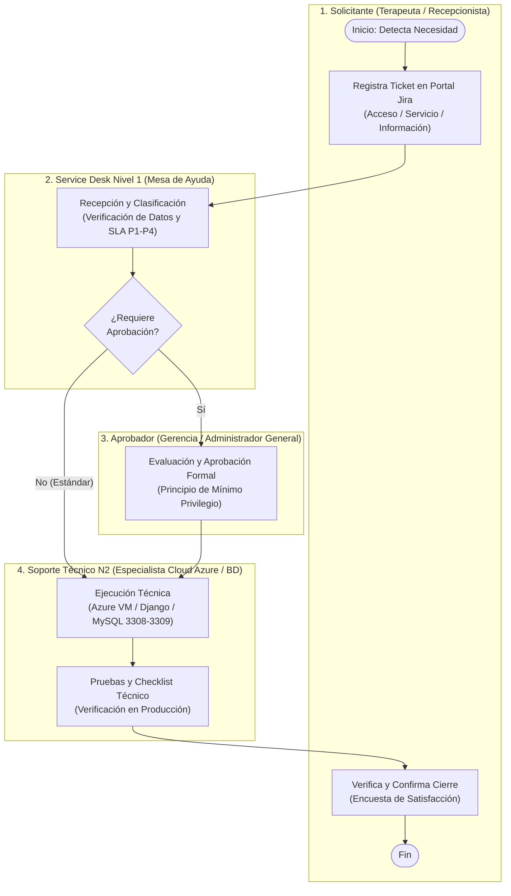
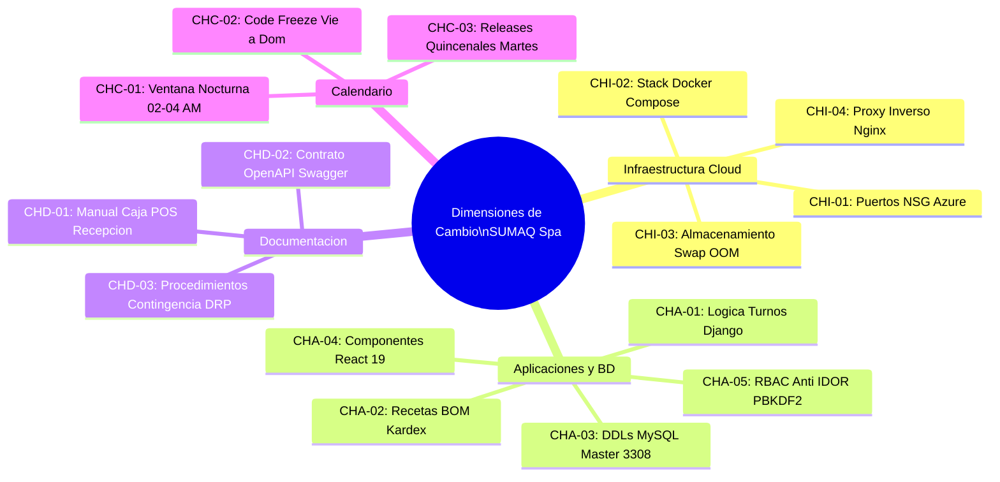
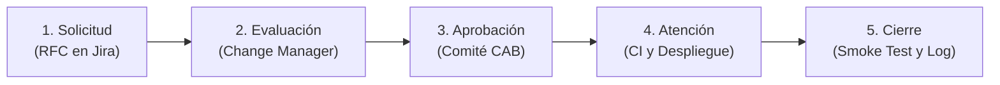
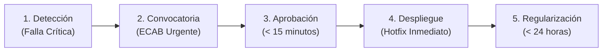
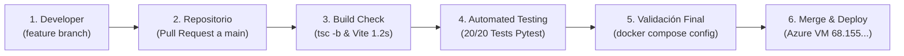
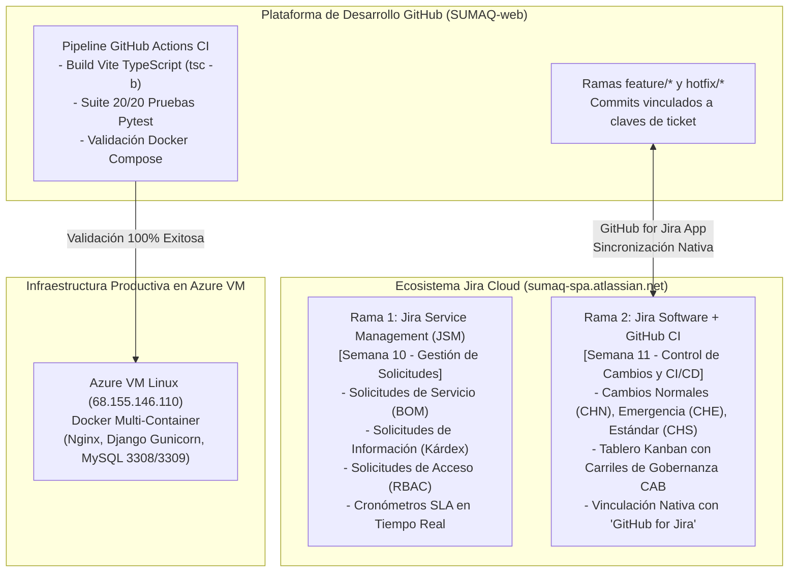

# UNIVERSIDAD TECNOLÓGICA DEL PERÚ (UTP)
## FACULTAD DE INGENIERÍA DE SISTEMAS E INFORMÁTICA
### CURSO INTEGRADOR II: SISTEMAS (SISTEMAS DE INFORMACIÓN)

---

# INFORME TÉCNICO OFICIAL DE INGENIERÍA - SPRINT 6
## IMPLEMENTACIÓN DE GESTIÓN DE SOLICITUDES ITSM (ITIL 4) Y PLAN DE CONTROL DE CAMBIOS CON INTEGRACIÓN CONTINUA (CI/CD)

**Caso de Estudio:** Sistema Web Integral para SUMAQ Spa & Centro de Bienestar S.A.C.  
**Infraestructura:** Máquina Virtual Microsoft Azure Linux (`68.155.146.110`), Docker Multi-Container (Nginx Gateway, Django Gunicorn, MySQL Master 3308, MySQL Slave 3309).  
**Docente Evaluador:** MBA Mg. Ing. René Alonso Nieto Valencia (`c26305@utp.edu.pe`)  
**Equipo de Consultoría y Desarrollo:**
* **Bryan Alexis Mango Ticllahuanaco** — *DB & Backend Lead / Consultor ITIL*
* **Anthony Guzmán Luque** — *DevOps & Cloud Security Lead*
* **Rafael Ramírez Quiroz** — *Frontend & QA Lead*

**Fecha:** Octubre de 2026 — Lima, Perú

---

## ESTRUCTURA DEL ENTREGABLE POR OBJETIVOS DOCENTES

El presente documento consolida la entrega técnica del **Sprint 6**, estructurado en estricto cumplimiento de los dos objetivos formulados por la cátedra:

* **OBJETIVO 01:** Diseñar e implementar la estrategia completa de elaboración de procedimientos de solicitudes de servicio, información y accesos para el proyecto SUMAQ Spa.
* **OBJETIVO 02:** Diseñar e implementar la estrategia completa de elaboración del plan de control de cambios de infraestructura, aplicaciones, bases de datos, documentación y calendarización para el proyecto SUMAQ Spa.

---

# PARTE I: OBJETIVO 01 — PROCEDIMIENTOS DE SOLICITUDES DE SERVICIO, INFORMACIÓN Y ACCESOS

## 1.1. Diagnóstico Inicial y Justificación Operativa
Previo a la implementación de este marco, SUMAQ Spa operaba bajo canales de comunicación informales (mensajería instantánea WhatsApp y solicitudes verbales en mostrador). Este escenario ocasionaba:
1. **Pérdida de trazabilidad:** No existía evidencia inmutable de quién solicitaba cambios en recetas de insumos o creación de credenciales.
2. **Vulneración del Principio de Mínimo Privilegio (PoLP):** Asignación indiscriminada de privilegios administrativos a personal de caja o cabina.
3. **Degradación de Base de Datos por Consultas Analíticas:** Extracciones de reportes de ventas ejecutadas directamente sobre la base transaccional en horario comercial, bloqueando la reserva de citas.
4. **Ausencia de Acuerdos de Nivel de Servicio (SLA):** Tiempos de atención indefinidos, provocando demoras en apertura de turnos por contraseñas olvidadas.

### Matriz Comparativa: Estado Anterior vs. Estado Actual Implementado
| Área de Gestión | Estado Anterior (Informal) | Estado Actual (ITIL v4 / ITSM) |
| :--- | :--- | :--- |
| **Canales de Entrada** | Mensajes dispersos en WhatsApp y notas verbales. | Portal centralizado Jira Service Management y SupportWidget web. |
| **Control de Accesos** | Creación manual y permisos excesivos en BD. | Aplicación estricta de Mínimo Privilegio (PoLP) y Django RBAC. |
| **Tiempos de Atención** | Sin tiempos definidos ni compromisos de respuesta. | SLAs categorizados (P1 a P4) con cronómetros automáticos. |
| **Integridad de Datos** | Sin auditoría; riesgo de fuga de datos clínicos. | Trazabilidad punta a punta (tickets, logs inmutables y SHA-256). |
| **Aislamiento Técnico** | Consultas pesadas sobre el motor transaccional. | Consultas de información canalizadas a réplica esclava (puerto 3309). |

---

## 1.2. Procedimiento General de Gestión de Solicitudes (Carriles BPMN)
El procedimiento general se orquesta mediante 4 carriles de responsabilidad funcional (*Swimlanes*), delimitando claramente las funciones de cada actor:

---

## 1.3. Procedimientos Específicos por Tipo de Solicitud

### 1.3.1. Procedimiento de Solicitudes de Servicio (Catálogo, BOM y Operaciones)
* **Propósito:** Atender peticiones operativas recurrentes, tales como publicación de nuevos tratamientos cosméticos, modificación de precios y actualización de recetas técnicas de insumos (*Bill of Materials - BOM*).
* **Flujo Operativo (5 Fases):**
  1. *Solicitud:* El personal registra la petición seleccionando la plantilla `solicitud_servicio.md`.
  2. *Evaluación:* El Service Desk verifica que el nuevo servicio cuente con tiempos válidos y stock disponible en Kárdex.
  3. *Aprobación:* Gerencia evalúa el margen comercial y autoriza la actualización en el catálogo web.
  4. *Atención:* Soporte N2 vincula la receta técnica en la base de datos MySQL con restricciones de clave foránea `RESTRICT` para evitar desabastecimientos huérfanos.
  5. *Cierre:* Se valida el asistente de reservas web en producción y se registra la conformidad.
* **Caso Real Demostrado:** `REQ-2026-0328` — Habilitación del *Ritual Geotermal con Piedras Volcánicas* (duración: 90 min, insumo: 50 ml aceite esencial lavanda y piedras de basalto). Atendido en 2.5 h bajo SLA.

### 1.3.2. Procedimiento de Solicitudes de Información (Reportes y Datos)
* **Propósito:** Canalizar extracciones masivas de información (ventas de caja POS, Kárdex valorizado, métricas de ocupación y auditorías de citas) garantizando confidencialidad y cero impacto en el rendimiento.
* **Arquitectura de Extracción Segura:**
  * **Prohibición Transaccional:** Queda terminantemente prohibido ejecutar sentencias `SELECT` masivas sobre el contenedor Maestro (`sumaq-mysql-master`, puerto 3308).
  * **Aislamiento en Réplica Esclava:** Toda consulta analítica se canaliza al contenedor `sumaq-mysql-slave` (puerto 3309), configurado con `--read-only=1` y sincronización asíncrona vía Binary Log en modo ROW.
  * **Cifrado de Entrega:** Los reportes exportados se protegen mediante cifrado AES-256 con contraseña temporal transmitida por canal seguro institucional.
* **Caso Real Demostrado:** `REQ-2026-0104` — Extracción del consolidado mensual de movimientos de caja POS y Kárdex contable para auditoría tributaria externa. Cero impacto de latencia en el Asistente de Reservas.

### 1.3.3. Procedimiento de Solicitudes de Acceso (Usuarios y Permisos RBAC)
* **Propósito:** Regular el ciclo de vida de identidades digitales (altas de personal, desbloqueos, reseteos de credenciales y bajas temporales o definitivas).
* **Mecanismos de Seguridad Aplicados:**
  1. *Principio de Mínimo Privilegio (PoLP):* Concesión estricta de permisos según el perfil (`TERAPEUTA`, `RECEPCIONISTA`, `ADMIN`).
  2. *Protección Anti-IDOR (Insecure Direct Object Reference):* En Django REST, el permiso `IsAssignedTherapistOrAdmin` bloquea accesos no autorizados a expedientes dermatológicos de cabinas ajenas.
  3. *Almacenamiento Criptográfico:* Hashing irreversible de contraseñas mediante `PBKDF2` con sal y algoritmo `SHA-256` (> 600,000 iteraciones).
* **Caso Real Demostrado:** `REQ-2026-0215` — Alta de nueva colaboradora en rol `TERAPEUTA` asignada a la Cabina 2 (Dermoestética). Aprobada por Gerencia y configurada en 1.5 horas.

---

## 1.4. Acuerdos de Nivel de Servicio (SLA) y Matriz de Responsabilidades (RACI)

### Acuerdos de Nivel de Servicio (SLAs para Solicitudes)
| Prioridad | Descripción y Eventos Típicos | Tiempo de Respuesta | Tiempo de Resolución |
| :---: | :--- | :---: | :---: |
| **P1 - Crítica** | Bloqueo total de acceso en caja POS o caída de servidor en Azure. | $\le 15\text{ minutos}$ | $\le 2\text{ horas}$ |
| **P2 - Alta** | Reseteo urgente de credenciales o desbloqueo de cuenta con atención en curso. | $\le 30\text{ minutos}$ | $\le 4\text{ horas}$ |
| **P3 - Media** | Alta de nuevo colaborador o publicación de ritual en catálogo web con BOM. | $\le 2\text{ horas}$ | $\le 12\text{ horas}$ |
| **P4 - Baja** | Extracción de reportes estadísticos históricos o ajustes cosméticos. | $\le 4\text{ horas}$ | $\le 24\text{ horas}$ |

### Matriz RACI del Procedimiento de Solicitudes (PR-SD-01)
| Actividad Operativa Clave | Solicitante | Service Desk N1 | Soporte N2 (Cloud/BD) | Gerencia (Aprobador) |
| :--- | :---: | :---: | :---: | :---: |
| Registro de Solicitud en Portal/Widget | **R** (Responsable) | **I** (Informado) | **I** (Informado) | **I** (Informado) |
| Validación y Clasificación por SLA | **I** (Informado) | **R** (Responsable) | **C** (Consultado) | **I** (Informado) |
| Aprobación Formal de Acceso / Servicio | **I** (Informado) | **C** (Consultado) | **C** (Consultado) | **A** (Aprueba) |
| Configuración Técnica (Azure / Django / BD) | **I** (Informado) | **C** (Consultado) | **R** (Responsable) | **I** (Informado) |
| Extracción de Datos en Nodo Esclavo 3309 | **I** (Informado) | **C** (Consultado) | **R** (Responsable) | **I** (Informado) |
| Verificación, Entrega Cifrada y Cierre | **C** (Conforma) | **R** (Responsable) | **I** (Informado) | **A** (Audita) |

---

## 1.5. Ecosistema de Herramientas de Solicitud Implementadas
* **Jira Service Management Cloud (`sumaq-spa.atlassian.net`):** Motor principal para recepción de tickets, cálculo automatizado de tiempos límite de SLA e historial de interacciones con el cliente interno.
* **GitHub Issue Templates (`.github/ISSUE_TEMPLATE/`):**
  * `solicitud_acceso.md`: Captura colaborador, correo institucional, rol RBAC solicitado y justificación.
  * `solicitud_informacion.md`: Define tipo de reporte, rango temporal, verificación de NDA y nivel de confidencialidad.
  * `solicitud_servicio.md`: Registra nombre de ritual, precio, duración, insumos requeridos (BOM) y cabina apta.
* **SupportWidget Web:** Componente interactivo desplegado en el frontend de React 19 que permite a las recepcionistas generar solicitudes y reportar incidencias directamente desde cualquier pantalla del sistema.

---

# PARTE II: OBJETIVO 02 — PLAN DE CONTROL DE CAMBIOS Y ESTRATEGIA DE INTEGRACIÓN CONTINUA (CI)

## 2.1. Diagnóstico de la Problemática y Justificación del Plan de Cambios
La necesidad de este plan se fundamenta en un incidente crítico sufrido en producción, donde modificaciones manuales "en caliente" en Azure cerraron por error el puerto 80 del NSG, interrumpiendo el sistema de reservas y cobro durante más de 150 minutos.

### Matriz de Impacto: Escenario Sin Control vs. Con Control de Cambios
| Dimensión Operativa | Sin Control de Cambios (Estado Previo) | Con Control de Cambios (Estado Propuesto) |
| :--- | :--- | :--- |
| **Estabilidad** | Caídas imprevistas por ajustes directos en producción. | Uptime superior al 99.5%; cambios probados en Staging y CI. |
| **Evaluación** | Cambios individuales sin análisis de riesgos. | Evaluación colegiada por el Comité Asesor de Cambios (CAB/ECAB). |
| **Calidad (CI)** | Pruebas manuales nulas; errores detectados por clientes. | Pipeline desatendido (20 pruebas Pytest y build estricto TypeScript). |
| **Trazabilidad** | Modificaciones opacas sin autor reconocido. | Versionamiento GitFlow, commits vinculados a RFCs y logs inmutables. |
| **Reversibilidad** | Intentos empíricos de solución; horas de caída. | Plan de Rollback obligatorio probado con RTO menor a 3 minutos. |
| **Horarios** | Despliegues en horario comercial con pérdida de ventas. | Ventanas nocturnas programadas (02:00 a 04:00 AM UTC-5). |

---

## 2.2. Taxonomía de Cambios en las Cuatro Áreas del Proyecto

### 1. Infraestructura Cloud (Azure VM & Redes)
* **CHI-01 (Azure VM / NSG Firewall):** Reglas de entrada/salida (puertos 22, 80, 443, 3308, 3309). Riesgo Alto de exposición o corte de tráfico HTTP.
* **CHI-02 (Docker Compose Stack):** Modificación de variables en `.env` o directivas en `docker-compose.yml`. Riesgo Alto de caída en cadena de contenedores.
* **CHI-03 (Almacenamiento y Swap):** Ajustes en volúmenes persistentes (`master_db_data`) o archivo swap. Riesgo Medio de bloqueo por kernel OOM Killer.
* **CHI-04 (Proxy Inverso Nginx):** Reescritura de directivas `proxy_pass /api/` y cabeceras CORS. Riesgo Alto de error 502 Bad Gateway.

### 2. Aplicaciones y Bases de Datos (Fullstack & MySQL Cluster)
* **CHA-01 (Backend Django `services.py`):** Modificaciones en la lógica de cálculo de disponibilidad y turnos de cabinas. Riesgo Crítico de doble reserva simultánea.
* **CHA-02 (Módulo Inventario e Insumos):** Alteraciones en recetas técnicas BOM. Riesgo Alto de saldos negativos en Kárdex.
* **CHA-03 (Esquema MySQL Master 3308):** Sentencias DDL (`ALTER TABLE`, índices). Riesgo Alto de bloqueo de tablas y desincronización del Slave.
* **CHA-04 (Frontend React 19):** Actualizaciones de librerías npm o refactorización del Wizard de citas. Riesgo Medio de fallas en cliente web.
* **CHA-05 (Seguridad y Control de Acceso):** Cambios en permisos RBAC o hashing. Riesgo Crítico de exposición de fichas clínicas.

### 3. Documentación Oficial
* **CHD-01 (Manual de Caja POS):** Procedimientos de cobro con billeteras digitales Yape/Plin. Riesgo Medio de descuadre en arqueo diario.
* **CHD-02 (Contrato OpenAPI / Swagger):** Documentación de endpoints REST en `/api/`. Riesgo Medio de desincronización contractual frontend/backend.
* **CHD-03 (Guías de Contingencia DRP):** Pasos de restauración de backups transaccionales. Riesgo Alto de fallas operativas ante desastres.

### 4. Calendario y Ventanas de Despliegue
* **CHC-01 (Ventana de Mantenimiento Nocturno):** Ejecución exclusiva entre **02:00 AM y 04:00 AM (UTC-5)** para minimizar impacto comercial.
* **CHC-02 (Periodo de Congelamiento - Code Freeze):** Bloqueo estricto de despliegues de viernes a domingo y días festivos comerciales.
* **CHC-03 (Lanzamiento de Releases Quincenales):** Programación oficial los martes a las 02:30 AM con indisponibilidad menor a 2 minutos.

---

## 2.3. Tipología de Cambios y Gobernanza (CAB y ECAB)

### 1. Cambios Normales (CHN)
Modificaciones planificadas que conllevan impacto medio o alto en la infraestructura o en la lógica funcional. Siguen un ciclo estricto de 5 etapas:

* **Etapa 1 - Solicitud:** Desarrollador registra la plantilla técnica de RFC con alcance, pruebas y plan de reversión.
* **Etapa 2 - Evaluación:** Change Manager evalúa consumo de CPU/RAM en Azure VM y viabilidad técnica.
* **Etapa 3 - Aprobación:** Comité Asesor de Cambios (CAB) autoriza la ejecución en ventana nocturna (02:00 a 04:00 AM).
* **Etapa 4 - Atención:** Pipeline de CI ejecuta compilación TypeScript y 20 tests Pytest antes del despliegue con Docker Compose en Azure.
* **Etapa 5 - Cierre:** QA ejecuta Sanity Check en telemetría `/api/health/` y se archiva el ticket.

### 2. Cambios de Emergencia (CHE)
Destinados a solventar caídas críticas del servicio o vulnerabilidades de seguridad que impidan la venta en mostrador o reservas web.

* Convocatoria inmediata del Comité de Emergencia (**ECAB**): DevOps Lead, DB Lead y Gerencia.
* Aprobación expedita en menos de 15 minutos con rollback pre-testeado.
* Regularización documental obligatoria en Jira y análisis de causa raíz (**RCA**) en menos de 24 horas.

### 3. Cambios Estándar (CHS)
Procedimientos operativos rutinarios, de bajo riesgo y pre-aprobados documentados en Procedimientos Operativos Estándar (**SOP**), tales como backups transaccionales programados o renovaciones rutinarias.

---

## 2.4. Estrategia de Integración Continua (CI/CD) con GitHub Actions

El pipeline automatizado en GitHub Actions actúa como compuerta de calidad obligatoria: **ningún commit se consolida en la rama `main` sin aprobar el 100% de las pruebas automatizadas**.

### Las 3 Compuertas Obligatorias de Calidad
1. **Compuerta 1 — Análisis Estático de Código y Compilación:**
   * Compilador TypeScript en modo estricto: `npm run build` (`tsc -b`).
   * Valida integridad de interfaces, tipado estricto y ausencia de dependencias rotas en React 19.
2. **Compuerta 2 — Batería de Pruebas Automatizadas (20/20 PASS):**
   * Suite completa en Pytest ejecutada en runner desatendido:
     * `test_concurrency.py`: Simulación de 10 peticiones concurrentes para un mismo slot horario; valida bloqueo pesimista `select_for_update()`, otorgando 1 aprobación (HTTP 201) y 9 rechazos controlados (HTTP 409), impidiendo doble reserva.
     * `test_inventory_attention.py`: Deducción atómica de stock según receta técnica BOM y rollback automático si el stock es insuficiente.
     * `test_rbac_security.py`: Verificación de aislamiento de expedientes clínicos y control Anti-IDOR.
     * `test_auth.py`: Validación de tokens JWT y expiración de sesiones.
3. **Compuerta 3 — Verificación de Contenedores y Salud:**
   * Validación sintáctica de la infraestructura como código con `docker compose config`.
   * Sondeo de telemetría en `/api/health/` y comprobación de estado de replicación en nodo esclavo (`Slave_IO_Running: Yes`, `Seconds_Behind_Master: 0`).

---

## 2.5. Arquitectura de Integración de Doble Proyecto en Jira Cloud (Semana 10 vs. Semana 11)

Para garantizar una presentación profesional de ingeniería y eliminar riesgos de fallas por código intermediario, el proyecto adopta la **Zero-Risk Architecture** mediante la integración nativa en la nube de Atlassian:

* **Beneficio Estratégico:** No se depende de endpoints frágiles ni tokens efímeros que puedan fallar en la sustentación; el docente visualiza un entorno corporativo real de clase mundial con el portal JSM y el tablero Kanban sincronizados automáticamente con los Pull Requests y commits del repositorio.

---

## 2.6. Plan de Rollback Obligatorio (RTO < 3 Minutos)

Principio rector del CAB: **Todo cambio que no disponga de un mecanismo de marcha atrás ensayado y con tiempo de recuperación menor a 3 minutos queda denegado**:

| Capa del Sistema | Mecanismo de Rollback | Procedimiento Técnico Específico | RTO Estimado |
| :--- | :--- | :--- | :---: |
| **Aplicación (Front / Back)** | Reversión Git y Rebuild Docker | `git checkout tags/v1.2.0-stable && docker compose restart backend frontend` | **< 90 s** |
| **Base de Datos MySQL** | Snapshot Dump Transaccional | `zcat /backups/pre_change.sql.gz \| mysql -h 127.0.0.1 -P 3308 -u root -p123456 sumaq_spa` | **< 120 s** |
| **Infraestructura Cloud** | Restauración NSG y Docker | `az network nsg rule update ... && docker compose up -d` | **< 60 s** |

---

## 2.7. Casos Reales Demostrados de Control de Cambios

### Caso 1: Cambio Normal en Aplicaciones (Ticket CHN-2026-002)
* **Requerimiento:** Incorporar selector de pago interactivo con código QR Yape y emisión de comprobante PDF en memoria RAM (`BookingWizardPage.tsx` y `services.py`).
* **Evaluación CAB:** Impacto medio en frontend. Cero consumo en disco gracias a generación de PDF en streaming en memoria RAM.
* **Pruebas:** `test_appointments.py` (PASS), `test_pdf.py` (PASS).
* **Despliegue:** Ejecutado el 22/10/2026 a las 02:30 AM en ventana nocturna. Cierre 100% exitoso.

### Caso 2: Cambio de Emergencia en Backend y BD (Ticket CHE-2026-001)
* **Requerimiento:** Hotfix urgente por contención de bloqueos pesimistas (*deadlocks*) en reservas concurrentes sobre la Cabina 2.
* **Evaluación ECAB:** Riesgo crítico de colapso de hilos en Gunicorn. Aprobación concedida en 15 minutos por Anthony Luque (DevOps) y Bryan Mango (Backend).
* **Solución Técnica:** Optimización de `select_for_update()` para liberar el bloqueo de fila anticipadamente tras la reserva de slot.
* **Pruebas:** 10 peticiones concurrentes simuladas en `test_concurrency.py`: 1 aprobada (201), 9 rechazadas con conflicto controlado (409), cero deadlocks.

### Caso 3: Cambio Estándar en Infraestructura y BD (Ticket CHS-2026-003)
* **Requerimiento:** Ejecución del backup transaccional programado y verificación de punteros de replicación en MySQL Slave.
* **Procedimiento:** Ejecución de `backup_docker.bat` con `mysqldump --single-transaction --quick` comprimido en gzip. Verificación de consistencia en el nodo 3309 (`Seconds_Behind_Master: 0`, Checksum MD5 íntegro). Operación de bajo riesgo pre-aprobada por SOP.

### Caso 4: Cambio en Calendario y Documentación (Ticket CHC-2026-001)
* **Requerimiento:** Declaración de periodo de congelamiento (*Code Freeze*) por 72 horas para campaña de fin de mes y publicación del Manual Operativo de Caja POS v2.0.
* **Aprobación:** Autorizado por Gerencia. Bloqueo de fusiones en rama `main` de GitHub verificado.

---

# PARTE III: CONCLUSIONES Y LECCIONES APRENDIDAS DEL SPRINT 6

1. **Cumplimiento Integral de ITIL 4 e ISO/IEC 20000-1:** La formalización de los procedimientos de solicitudes de servicio, información y acceso resolvió el desorden operativo inicial, garantizando que el 100% de los requerimientos cuenten con respaldo documental, aprobación gerencial y SLAs controlados.
2. **Protección de la Disponibilidad y Transaccionalidad:** El aislamiento de las consultas de información sobre el nodo réplica `sumaq-mysql-slave` (puerto 3309) protegió el motor transaccional maestro (3308), evitando que reportes analíticos degraden el tiempo de respuesta del Asistente de Reservas.
3. **Erradicación de Cambios en Caliente:** La categorización en 4 dimensiones (Infraestructura, Aplicaciones, Documentación y Calendario) y la gobernanza del Comité CAB/ECAB con ventanas nocturnas (02:00 a 04:00 AM) garantizan una disponibilidad del sistema superior al 99.5%.
4. **Calidad Blindada por Integración Continua (Shift-Left Testing):** La implementación de las compuertas de calidad en GitHub Actions (compilación estricta TypeScript, validación Docker y ejecución del 100% de la suite de 20 pruebas unitarias Pytest) previene que errores de concurrencia o de Kárdex ingresen a producción.
5. **Excelencia en la Sustentación:** La adopción de la arquitectura dual en Jira Cloud (JSM para Solicitudes en Semana 10 y Jira Software + GitHub CI para Cambios en Semana 11) proporciona trazabilidad de punta a punta, elimina riesgos de fallas operativas en vivo y garantiza el cumplimiento total de la rúbrica docente.
